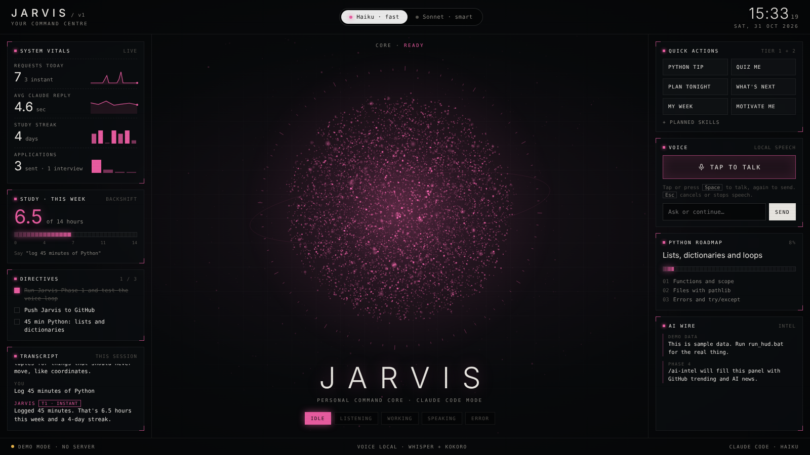
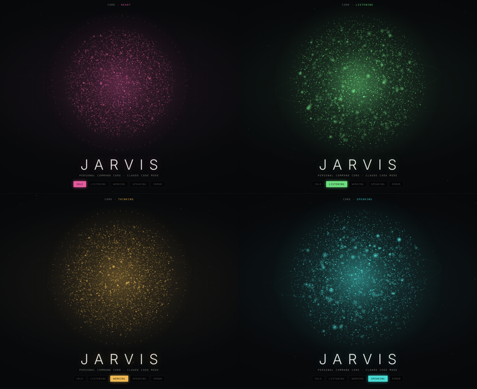
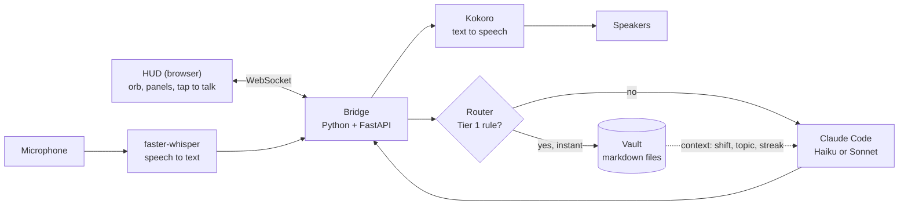

# Jarvis

A voice-driven personal assistant for Windows. You talk to it, it thinks with Claude Code, and it answers out loud, with a live HUD in the browser showing what it's doing.

Speech recognition and the voice both run locally on the PC. Simple requests ("log 45 minutes of Python", "what's my streak?") are answered instantly from local markdown files with no AI at all; everything else goes to Claude.


<sub>The HUD with demo data. The orb changes colour and motion with Jarvis's state.</sub>


<sub>Idle, listening, thinking, speaking. The orb swells with your voice and ripples while Jarvis talks.</sub>

## How it works



1. Press **Tap to talk** (or Space) and speak.
2. **faster-whisper** turns the audio into text on the PC.
3. The **router** checks it against a set of rules. If one matches (logging study time, setting your shift, ticking off a task), it reads or updates the vault and answers in milliseconds: **Tier 1**.
4. Otherwise it goes to **Claude Code** in headless mode (`claude -p`) with a short summary of where things stand (shift, current topic, streak, open tasks): **Tier 2**.
5. **Kokoro** speaks the reply sentence by sentence, streaming the voice level to the orb so it pulses in time.
6. Every request is logged to a daily note in the vault; the HUD's panels are built live from the vault.

## Tech

| Part | Tool |
| --- | --- |
| Backend | Python 3.12, FastAPI, WebSockets, asyncio |
| Speech to text | faster-whisper (local) |
| Text to speech | Kokoro via kokoro-onnx (local) |
| AI | Claude Code CLI, headless |
| HUD | HTML, CSS and JavaScript; the orb is a 3D particle system on a 2D canvas, no libraries |
| Memory | Plain markdown files (Obsidian-compatible) |
| Tests | pytest, 41 tests covering the router and memory |
| Environment | uv |

## Run it

Needs Windows, Python 3.10+, and [Claude Code](https://claude.com/claude-code) installed and logged in.

1. In `phase1/`, double-click **setup.bat** (once). It creates a Python 3.12 environment and installs everything.
2. Double-click **run_hud.bat**. It opens the HUD at http://localhost:8765.
3. Or double-click **run_jarvis.bat** for the terminal-only version.

The first run downloads the speech models (about 850 MB).

## Things you can say

| Say | Tier | What happens |
| --- | --- | --- |
| "Log 45 minutes of Python" | 1 | Adds to the study log; streak and weekly hours update |
| "What's my streak?" / "How many hours this week?" | 1 | Read from the study log |
| "I'm on backshift this week" | 1 | Saves your shift; Claude plans around it |
| "Add a task to update my CV" / "Tick off CV" | 1 | Edits `directives.md` |
| "I've finished lists" / "What's next on my roadmap?" | 1 | Ticks off and reads `roadmap.md` |
| "I applied for a junior developer role at Acme" | 1 | Adds to the job pipeline |
| Anything else | 2 | Claude Code answers, knowing your shift, topic and streak |

## Tests

```
.venv\Scripts\python.exe -m pytest
```

## Roadmap

- [x] **Phase 1:** voice loop: Whisper, Claude Code, Kokoro
- [x] **Phase 2:** markdown memory vault, Tier 1 router for instant answers, context-aware Claude calls, tests
- [x] **Phase 3 (early):** HUD with live state, orb, quick actions, model switch
- [ ] **Phase 4:** scheduled skills: daily plan, AI news brief, study sessions
- [ ] **Phase 5:** job tools, phone access

## Licence

MIT
