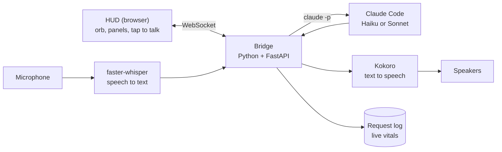

# Jarvis

A voice-driven personal assistant for Windows. You talk to it, it thinks with Claude Code, and it answers out loud, with a live HUD in the browser showing what it's doing.

Speech recognition and the voice both run locally on the PC. Only the thinking goes to Claude.

The HUD with demo data. The orb changes colour and motion with Jarvis's state.

Idle, listening, thinking, speaking. The orb swells with your voice and ripples while Jarvis talks.

## How it works

1. Press **Tap to talk** (or Space) and speak.
2. **faster-whisper** turns the audio into text on the PC.
3. The bridge sends it to **Claude Code** in headless mode (`claude -p`), continuing the same conversation.
4. **Kokoro** speaks the reply sentence by sentence, streaming the voice level to the orb so it pulses in time.
5. Every request is logged; the HUD's vitals (requests today, average reply time) are built from that log.

## Tech

| Part | Tool |
| --- | --- |
| Backend | Python 3.12, FastAPI, WebSockets, asyncio |
| Speech to text | faster-whisper (local) |
| Text to speech | Kokoro via kokoro-onnx (local) |
| AI | Claude Code CLI, headless |
| HUD | HTML, CSS and JavaScript; the orb is a 3D particle system on a 2D canvas, no libraries |
| Environment | uv |

## Run it

Needs Windows, Python 3.10+, and [Claude Code](https://claude.com/claude-code) installed and logged in.

1. In `phase1/`, double-click **setup.bat** (once). It creates a Python 3.12 environment and installs everything.
2. Double-click **run_hud.bat**. It opens the HUD at http://localhost:8765.
3. Or double-click **run_jarvis.bat** for the terminal-only version.

The first run downloads the speech models (about 850 MB).

## Roadmap

- [x] **Phase 1:** voice loop: Whisper, Claude Code, Kokoro
- [x] **Phase 3 (early):** HUD with live state, orb, quick actions, model switch
- [ ] **Phase 2:** memory in markdown files, plus a router that answers simple questions instantly without AI
- [ ] **Phase 4:** scheduled skills: daily plan, AI news brief, study sessions
- [ ] **Phase 5:** tests, phone access

## Licence

MIT
